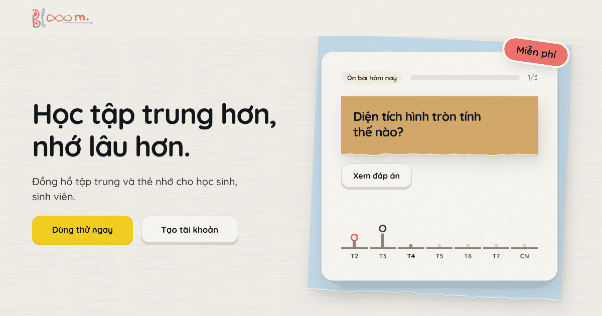

<div align="center">


# Blooom

**Học tập trung hơn, nhớ lâu hơn.**

Đồng hồ tập trung, thẻ nhớ tự nhắc ôn và nhóm học cho học sinh, sinh viên.

[](https://github.com/gmtigrisva123/Blooom-Project/actions/workflows/ci.yml)
[](https://github.com/gmtigrisva123/Blooom-Project/actions/workflows/deploy.yml)
[](LICENSE)

[**Xem bản chạy thật**](https://blooom-project.vercel.app/)



</div>

---

## Blooom làm gì

| Trang          | Nội dung                                                                              |
| -------------- | ------------------------------------------------------------------------------------- |
| **Hôm nay**    | Bắt đầu học trong một lần bấm, ba việc cần làm hôm nay, biểu đồ 7 ngày                |
| **Tập trung**  | Đồng hồ đếm giờ học và giờ nghỉ, chạy xuyên suốt các trang, lưu cả phiên kết thúc sớm |
| **Thẻ nhớ**    | Thẻ hỏi đáp quay lại đúng lúc sắp quên; ôn bằng bàn phím (Space, 1 đến 4)             |
| **Tài liệu**   | Ảnh chụp vở và tệp PDF, xếp theo môn                                                  |
| **Nhóm học**   | Tìm nhóm theo môn hoặc lập nhóm riêng                                                 |
| **Tiến độ**    | Mục tiêu tuần, so với tuần trước, giờ học tốt nhất trong ngày, huy hiệu               |
| **Thử nghiệm** | So sánh hai cách học (ví dụ: nghe nhạc hay im lặng) bằng chính số liệu của bạn        |
| **Mẹo học**    | Bài viết ngắn về cách học, do biên tập viên đăng                                      |

Dùng thử không cần tài khoản: bấm một nút là vào học. Khi tạo tài khoản, mọi thứ đã làm vẫn còn nguyên.

Mỗi trang có địa chỉ riêng, nên nút quay lại, tải lại trang và đánh dấu trang đều hoạt động. `Ctrl/⌘ + K` mở ô tìm nhanh, tìm được cả khi gõ không dấu.

### Nguyên tắc về dữ liệu

Ứng dụng không có dữ liệu mẫu. Tài khoản mới thấy màn hình trống kèm hướng dẫn, và mọi con số đều tính từ việc học thật của chính người dùng. Chuỗi ngày, điểm, cấp độ và huy hiệu luôn được tính lại từ dữ liệu gốc chứ không lưu riêng. Toàn bộ dữ liệu tải về được dưới dạng JSON từ menu tài khoản.

Khi thiếu cấu hình cơ sở dữ liệu, ứng dụng hiện thông báo thay vì âm thầm lưu tạm trong trình duyệt, để không bao giờ có chuyện giao diện chạy bình thường trong khi dữ liệu không được lưu.

## Thiết kế

Giao diện là một thế giới **giấy cắt thủ công**: giấy kem có vân, nút bấm kiểu bìa cứng nhấn xuống được, mực xanh đen, và một khu vườn lớn lên theo số phút học mỗi ngày. Toàn bộ hệ thống thiết kế được mô tả trong [`DESIGN.md`](DESIGN.md) (định dạng [design.md](https://github.com/google-labs-code/design.md)); mọi màu sắc và phông chữ chỉ được khai báo ở [`src/styles/tokens.css`](src/styles/tokens.css).

Vài quy tắc được giữ xuyên suốt:

- Bốn màu nhấn, mỗi màu một việc: lê vàng cho hành động, xanh dương cho liên kết và viền tiêu điểm, san hô cho một điểm nhấn duy nhất, bạc hà cho sự tăng trưởng.
- Không có thuật ngữ mà người mới vào phải tra cứu; không có số liệu, lời khen hay logo bịa.
- Chỉ chuyển động `transform` và `opacity`; mọi chuyển động đều dừng khi người dùng bật giảm chuyển động.
- CSS thuần, không framework; phông Quicksand tự lưu trữ, đủ dấu tiếng Việt.

Ảnh sản phẩm trên trang giới thiệu (`public/shots/`) là ảnh chụp thật của ứng dụng.

## Bắt đầu

**Yêu cầu:** Node.js 22.12 trở lên và một dự án [Supabase](https://supabase.com) (gói miễn phí là đủ).

```bash
git clone https://github.com/gmtigrisva123/Blooom-Project.git
cd Blooom-Project
npm install
```

1. Trong Supabase, mở **SQL Editor** và lần lượt chạy hai tệp trong `supabase/migrations`.
2. Muốn có nút "Dùng thử": **Authentication › Sign In / Providers** › bật **Allow anonymous sign-ins**.
3. Chép `.env.example` thành `.env` rồi điền `VITE_SUPABASE_URL` và `VITE_SUPABASE_ANON_KEY` (chỉ dùng khóa `anon`, không bao giờ dùng `service_role`).

| Lệnh              | Tác dụng                                         |
| ----------------- | ------------------------------------------------ |
| `npm run dev`     | Chạy máy chủ phát triển                          |
| `npm run build`   | Build bản production vào `dist/`                 |
| `npm run preview` | Xem thử bản đã build                             |
| `npm run lint`    | Kiểm tra mã bằng ESLint                          |
| `npm run format`  | Định dạng mã bằng Prettier                       |
| `npm run verify`  | Lint, kiểm tra định dạng và build (giống hệt CI) |

## Cấu trúc dự án

```
DESIGN.md                 Hệ thống thiết kế
supabase/migrations/      Lược đồ cơ sở dữ liệu, quyền truy cập từng hàng, quyền biên tập viên
public/                   Logo, biểu tượng, ảnh chụp sản phẩm
src/
├── App.jsx               Chọn màn hình: giới thiệu, đăng nhập hoặc ứng dụng
├── components/
│   ├── landing/          Trang giới thiệu, thẻ nhớ dùng thử, biểu đồ trí nhớ
│   ├── auth/             Đăng nhập, đăng ký, xác nhận email
│   ├── shell/            Thanh bên, thanh trên, thanh tab, tìm nhanh, tài khoản
│   ├── pages/            Tám trang của ứng dụng
│   └── ui/               Hộp thoại, mảnh giấy xé, khu vườn, các phần dùng chung
├── context/              Dữ liệu của người dùng, đồng hồ tập trung, thông báo
├── lib/                  Định tuyến, môn học, thời gian, thống kê, giấy
├── services/             Supabase, tài khoản, lịch ôn thẻ, thử nghiệm, huy hiệu
└── styles/               tokens → base → ui → landing, auth, shell, pages
```

## Dữ liệu và bảo mật

Toàn bộ dữ liệu nằm trong PostgreSQL do Supabase quản lý. Row Level Security bật trên mọi bảng: mỗi người chỉ đọc và ghi được dữ liệu của chính mình, trừ nhóm học công khai và bài viết đã đăng. Mật khẩu do Supabase Auth xử lý; ứng dụng không bao giờ đọc được.

Quyền đăng bài ở mục Mẹo học đi qua một mã 6 ký tự được kiểm tra hoàn toàn ở máy chủ (`supabase/migrations/0002_admin_access_code.sql`); không tệp nào trong `src/` biết mã đúng là gì.

## Tự động hóa

| Quy trình                                                          | Khi nào chạy                        | Làm gì                             |
| ------------------------------------------------------------------ | ----------------------------------- | ---------------------------------- |
| [`ci.yml`](.github/workflows/ci.yml)                               | Mỗi push và pull request            | Lint, kiểm tra định dạng, build    |
| [`deploy.yml`](.github/workflows/deploy.yml)                       | Push vào `main` + ngày 1 hằng tháng | Build và deploy lên GitHub Pages   |
| [`lighthouse.yml`](.github/workflows/lighthouse.yml)               | Ngày 1 hằng tháng                   | Chấm điểm hiệu năng, tiếp cận, SEO |
| [`monthly-ui-review.yml`](.github/workflows/monthly-ui-review.yml) | Ngày 1 hằng tháng                   | Mở issue rà soát giao diện         |
| [`dependabot.yml`](.github/dependabot.yml)                         | Hằng tháng                          | Mở PR nâng cấp thư viện            |

## Công nghệ

[React 18](https://react.dev), [Vite](https://vite.dev), [Supabase](https://supabase.com), [GSAP](https://gsap.com) cho hai chuyển động có chủ đích trên trang giới thiệu, [lucide-react](https://lucide.dev) cho biểu tượng, [canvas-confetti](https://github.com/catdad/canvas-confetti) khi hoàn thành phiên học, phông [Quicksand](https://fonts.google.com/specimen/Quicksand) qua Fontsource.

## Đóng góp

Xem [CONTRIBUTING.md](CONTRIBUTING.md).

## Giấy phép

[MIT](LICENSE), © 2026 Viet Anh Ho.
